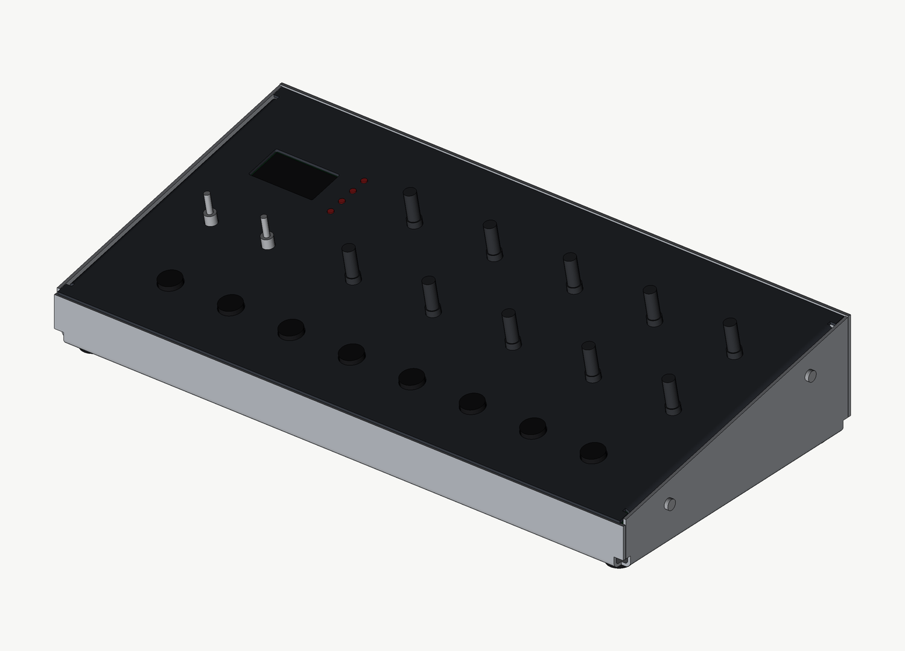
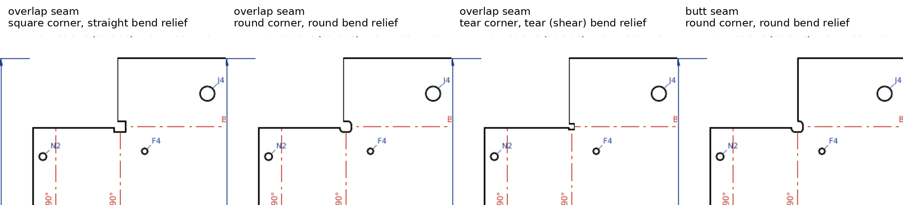

# qfold

Lightweight, agent-friendly sheet metal CAD. You describe a sheet metal body
as a tree of flat faces joined by flanges. qfold turns that into exact solids
and flat patterns, assembles them with other parts using `align`, and checks,
renders and draws the result. The geometry kernel is
[OpenCascade](https://github.com/Open-Cascade-SAS/OCCT), driven by a small C++
tool. Names follow Autodesk Fusion: Design, Component, Occurrence, Body,
Flange, Sheet Metal Rule.

Where this is going and what we decided not to build: [DIRECTION.md](DIRECTION.md).



## Quick start

```bash
scripts/bootstrap.sh              # once per checkout: about a minute, needs only git
python -m examples.pedal_box out  # build a design: about 15 s
```

A design is one Python file that builds a `Design` and hands it to a
`Project`. The project does the rest. Every build writes, into the output
folder:

| File | What it is |
| --- | --- |
| `<part>.step`, `assembly.step` | Each sheet metal part and the whole design, exact B-rep, mm |
| `<part>_flat.dxf` | Flat patterns: `CUT` layer, `BEND` centre lines, `NOTES` |
| `<name>_drawing.pdf`, `preview/sheet-*.png` | Assembly sheet, one sheet per part (flat pattern, hole and bend tables, views), holes as assembled, checks |
| `render_iso.png` | Shaded render |
| `report.json` | Parameters, every check, every hole's final position, sizes, parts list |

It prints one line per check and exits non-zero if any fails.

Three examples, each with committed output in their `out/` folder:

- [`examples/pedal_box`](examples/pedal_box/__main__.py): a tray with lips and
  a flat lid, 130 lines. **Copy this to start a new design.**
- [`examples/chassis`](examples/chassis/__main__.py): a U-channel with a
  board inserted from a STEP file on standoffs, 65 lines.
- [`examples/synth_case`](examples/synth_case): a sloped desktop synth case
  with a control board inserted from a STEP file and its own drawing sheets.

## Your first design

Copy `examples/pedal_box` to `designs/<name>/` and run it with
`python -m designs.<name> out`. The pieces, in the order the file uses them:

**1. Parameters.** One dataclass at the top. It is recorded in `report.json`
and on the drawing, so every output can be traced to the numbers that made it.

**2. Shop and material.** `shops.spec("jlccnc", "Aluminum 5052", 1.5)` gives
the sheet metal rule (thickness, bend radius, K) and that shop's limits.
See Shop data below.

**3. Sheet metal parts.** Describe each part by its outside dimensions and
let `Sheet` do the bend math:

```python
tray = Sheet("tray", shop)
base = tray.base(140, 100)                       # outside width (x) × depth (y)
base.flange("front", 40, name="front_wall")      # outside height
side = base.flange("right", 38.5, name="right_wall")
side.flange("top", 14, name="right_lip")         # a lip folding inward off the wall's top
```

- **Dimensions are outside dimensions** unless you say otherwise: the ones
  you would measure with a ruler on the finished part. A wall's height runs
  from the outside of the face it rises from to its far edge, or to the
  outside of a flange on that edge. `Sheet(..., dims="inside")` makes every
  dimension an inside one (the base between the inside faces of its walls, a
  height from the inside of the floor); `inside=True` or `False` on one
  `base()` or `flange()` overrides it. Bend set-backs, radii and allowances
  never appear.
- **Edges:** the base has `front` (y = 0), `back`, `left` (x = 0), `right`.
  A wall has `top`, `start` and `end`.
- **Coordinates:** the base's outside surface is z = 0 and its outside
  front-left corner is the origin. Walls fold up; `Sheet(..., up=False)` folds
  them down from a top surface at z = 0 (a lid or panel).
- **More:** `height=(20, 45)` slopes a wall's top edge; `start=`/`end=` put a
  flange on part of an edge (a tab); `angle=` and `radius=` set the bend;
  `extend=(80, 0)` runs a wall on past the end of the edge it hangs from, and
  `extend_drop=(11, None)` slopes that extension's edge down to its tip (a
  cheek that carries on beyond its panel, as in `designs/keybed_case`).

How corners are built is three separate choices, named as in Fusion's sheet
metal rules. All 27 combinations are tested as sound solids:

| Option | Choices |
| --- | --- |
| `corner=` how two walls meet | `"overlap"`: one runs the full outside length, the other tucks in behind it (the wall made first goes over; `over=True/False` on a flange chooses). `"butt"`: both stop at the inside corner, leaving the outside corner open by one thickness. `"open"`: each wall is only as wide as its bend. `corner_gap=` sets the gap. |
| `corner_relief=` where two bends meet | `"square"`: a small square cut from the corner. `"round"`: the same with a round inside. `"tear"`: nothing cut; the bends run to the corner and the material tears there. The tightest corner, reported as a warning. |
| `bend_relief=` beside a bend that ends next to more material | `"straight"`: a slot. `"round"`: a slot with rounded ends. `"tear"` or `"shear"`: a slit one laser kerf wide (`kerf=`, default 0.2 mm) that stops at the bend, for parts that sit as close as they can be cut. `relief=` on one flange overrides it. |

Sizes come from the shop's rule and can be set: `relief_width=` (default the
shop's, else T), `relief_depth=` (default R + T + 0.5 mm from the bend's
centre line). qfold doesn't forbid a combination the shop might refuse, such
as a slit narrower than its minimum feature: check with the shop for those.



For shapes `Sheet` can't describe, the layer beneath it is in `fold.py`:
`Face` outlines with `Flange`s, in bend-line coordinates. The synth case is
written that way.

**4. Holes.** Put them where they are on the finished part:

```python
tray.hole("back_wall", (50, 100, 15), Hole("circle", d=8.2, label="DC jack", tag="J4"))
```

The point is x, y, z on the part; the tool finds the spot on the face, so a
hole on a wall can't be mirrored. A point that isn't on that face is an error.
Kinds: `circle` (d), `rrect` (w, h, r, rot), `poly` (pts). A `tag` makes the
hole a named reference; `edge_cl` sets a minimum centre-to-edge distance for
pressed-in hardware.

**5. Assembly.** `tray.component()` makes a component with a ref on every
tagged hole: `"J4"` on the outside surface, `"J4.inside"` on
the inside, both with z pointing out of the part. Add components to a
`Design` and place them with `align`:

```python
lid_occ = d.add(lid, "lid")
align(lid_occ, "origin", onto=tray_occ.ref("lid_seat"))     # a ref you added with add_ref
align(d.add(screw, "screw_1"), "origin", onto=lid_occ.ref("C1"))
align(board, "RV1", onto=panel.ref("P6.inside"))            # an inserted STEP, by one part
```

`offset`, `angle` (about the target's z) and `flip` (turn the part over, for
one that stands on an inside face) adjust the result. `frame((x, y, z))` makes
a target from plain coordinates.

Other parts come from three places:

```python
parts.screw_m3x6()                                   # stand-ins in qfold/parts.py
post = prim_component("standoff_M3x8", [cyl((0, 0, 0), 6.0, 8.0)])   # your own: cyl(base point,
                                                     # diameter, length), box(corner, dx, dy, dz)
board = insert_step(d, "board.step", name="board")   # a real part or assembly
```

A part's origin is its mounting point, with z pointing out of the case. An
inserted STEP keeps its product names: a part called `RV1` in the file is the
occurrence `"board/RV1"`, and `align(board, "RV1", onto=...)` places the whole
board by that part.

**6. Project.** Say what must hold, then build:

```python
p = Project("pedal_box", design, shop=shop, params=params)
p.seated(["screw_1", "screw_2"], onto="lid", name="screw heads on the lid")  # touching, no overlap
p.seated("led", onto="lid", touch=False)        # in its hole with clearance: no overlap only
p.clear("pcb", "tray", min=2.0)                 # at least this far apart
p.on_hole("screw_1", "lid:C1")                  # on the hole's axis, at its depth, square to it
p.ghost("key_travel")                           # a keep-out or swept space, not a part: checked
                                                # against, but left out of renders, STEP and parts list
p.check(fn)                                     # anything else: fn(build) adds rows to build.rep
sys.exit(p.main())
```

Occurrences are named by path (`"lid"`, `"control_board/RV1"`), holes by
`"path:tag"`. `p.views["render_back"] = (-1, 1.3, 0.8)` adds a render from another
direction. `p.check_fit(workdir)` runs only the fit checks, in about two
seconds, for a quick answer while moving parts around.

**7. Look at the result.** Checks prove the model is consistent, not that it
is what you meant: a hole in the wrong place passes them all. Read the
"Holes as assembled" sheet (or `holes` in `report.json`), which lists every
hole's final x, y, z and the way it faces, and look at `render_iso.png` and
the part sheets.

## Checks

Every build runs these without being asked:

- **Each sheet metal part:** it is one valid solid that doesn't intersect
  itself. The fused solid must hold exactly the volume of its unfused plates
  and bends, folded and flat. Folded minus flat volume must equal what the
  bend allowance predicts (θ·L·T²·(0.5 − K) per bend). Together these show
  the flat pattern and the folded part are the same sheet. They don't prove
  the bend allowance matches the press brake; that's what the shop's
  K-factor is for.
- **DFM:** hole to bend (for each bend's own radius), hole to edge, web between
  holes, holes inside their face, minimum hole size, hardware centre-to-edge
  distance, bend corner relief, minimum flange length, sheet size. Limits come
  from the shop, or from the defaults in `dfm.Rules`.
- **Gaps inside a part:** faces that only meet at a corner, such as two walls,
  must keep `min_clearance` apart.
- **Assembly:** no top-level part may overlap the rest. (What's inside an
  inserted STEP is taken as given.)
- **Files:** every STEP is read back and its volume and solid count compared
  with the model. Every DXF is re-opened and checked against the flat pattern:
  extent, each circle's centre and diameter, line and arc counts, total cut
  length, and the bend lines with their DN/UP labels.

And the fits the design declares (`seated`, `clear`, `on_hole`). Each part is
checked on its own, so one lifted screw fails by name even when the other
three are fine. The synth case adds one of its own: every panel hole has a
board part and every board part a hole.

The tests break designs on purpose to show the checks bite: a
self-intersecting corner, bends meeting without relief, a hole crossing an
edge, and single parts lifted, slid or pushed in by fractions of a millimetre.

## How it works

```
qfold/
  sheet.py     Sheet: a part from outside dimensions, with corners and reliefs worked out
  fold.py      sheet metal body -> folded plates + bend sectors, and flat pattern
  assembly.py  Design, Component, Occurrence, Body, refs, align, insert_step
  project.py   Project: declare fits, then build, check, export, draw
  dfm.py       manufacturing rules on the layout
  shops.py     fab shop bend tables and limits (data in shop_data/*.json)
  parts.py     stand-in hardware (pots, switches, screws, feet, PCB)
  flat.py      flat pattern in outside-face view, DXF export
  sheets.py    the default drawing sheets
  drawing.py   SVG sheets: views from hidden-line removal, dims, tables
  render.py    numpy z-buffer renderer (no GPU or display)
  kernel.py    runs sheetkernel
kernel/        sheetkernel (C++/OCCT): bodies + placed instances in, answers out
examples/      pedal_box (the template), chassis, synth_case
```

Python owns the design, the fold math and the assembly tree. The kernel owns
geometry truth and stays stateless: it sees a flat list of body prototypes and
world-placed instances, never the tree. Both states of a sheet metal body come
from the same description, so there is no unfold step that can fail. Sizes on
the drawings are the kernel's measurements of the solids. Hole tables come
from the model tree. None are typed in.

| Fusion | qfold |
| --- | --- |
| Design, root component | `Design` |
| Component | `Component`: bodies, child occurrences, named refs |
| Occurrence | `Occurrence`: one placed instance of a component |
| Body | `Body`: sheet metal, STEP, or box-and-cylinder stand-in |
| Insert into current design (STEP) | `insert_step`: products become components, instances become occurrences |
| Modify › Align | `align` |
| Parts List | `Design.parts_list()` |
| Sheet Metal Rule, Flange | `SheetMetalRule`, `Flange` |

Placement happens once per run, with no solver. The design is rebuilt from
code each time, so an align against "hole P6" follows the hole when it moves.

Other conventions:

- Bend allowance is θ·(R + K·T), with R the inside radius.
- Flat patterns are shown from the outside face. `DN` means the bend folds
  away from the viewer.
- The synth case's values (R1.6, K 0.42, hole sizes, stand-in hardware) are
  placeholders. A real design takes its rule from a shop and its parts from
  vendor STEP files.

## Shop data

`qfold/shop_data/` holds what each shop publishes about bending and cutting,
copied from its own pages in its own units. The source pages and the date
they were read are in each file. `qfold.shops.spec(shop, material,
thickness_mm)` turns one row into qfold's terms, in mm:

```python
from qfold import shops
s = shops.spec("sendcutsend", "5052 Aluminum", 1.6)
s.rule   # SheetMetalRule: T 1.6002, R 0.889, K 0.455
s.rules  # dfm.Rules: hole to bend 4.72, min flange 5.21, min hole 0.80, sheet 1118 × 762
s.notes  # anything to know, e.g. where K came from
```

| Shop | Bend radius and K | Limits |
| --- | --- | --- |
| SendCutSend | per material and thickness, 10 materials | die-based hole to bend, min flange, min hole, max bent size, max bend length |
| OSH Cut | not public: in their app (app.oshcut.com/catalog) | min hole, web, part size and tolerance per thickness for 5052, A1008, 304, G90 |
| JLCCNC | radius per thickness (outer corner radius − T); K not published | min flange per thickness, hole to bend, edge, web, min hole, 800 mm max; 11 stock thicknesses, nominal and actual |

For OSH Cut, `rule` stays None until you pass `bend_radius=` and
`k_factor=` read from their app. The limits are there either way.

JLCCNC requires a STEP model for orders and lays out the flat pattern from it
itself, so its unpublished K never reaches the part. It only shapes qfold's
own flat drawing. qfold uses the middle of JLCCNC's design-guide range unless
you pass `k_factor=`. The minimum flanges and the 3 mm hole-to-bend rule come
from JLC's Chinese bending article. JLCCNC stocks 1.5 mm, not 1.6, and its
1.5 mm sheet is actually 1.42 mm thick: the notes give the actual thickness. Names are
the shop's own: `shops.materials(shop)` lists them with their stock
thicknesses, and a wrong name or thickness lists the valid ones.

How the published numbers map to qfold's checks:

- SendCutSend's printed K has two decimals. On four rows it disagrees with
  the bend deduction printed beside it, including 0.063 in 5052. qfold uses
  the K that reproduces the bend deduction, since that is what lays out the
  flat pattern. For every row, a test checks that a 90° bend from qfold
  flattens by exactly the shop's bend deduction.
- Formed flange minimums are measured from the outside of the other leg.
  qfold checks the flat wall past the bend, which is R + T shorter. The
  converted value matches SendCutSend's own flat minimum (from the bend
  centre line) to within 0.002 in.
- "Cut features at least half the die width from the bend centre line"
  becomes the hole-to-bend distance from the tangent line: (die − BA)/2.

The synth case passes SendCutSend's limits in 1.6 mm 5052 and JLCCNC's in 1.5 mm 5052, as designed.

## Setup

On a fresh checkout, one command gets everything and runs the tests. It takes
about a minute and needs only git, so it works in sandboxes without PyPI:

```bash
scripts/bootstrap.sh
python -m examples.pedal_box out
```

The bootstrap script:

- **Checks the platform and tools.** It stops early, with a clear message, if
  the machine isn't Linux x86_64 or is missing git, g++, `rsvg-convert`,
  `qpdf`, `pdftoppm`, numpy, Pillow or pytest.
- **Fetches OpenCascade.** It shallow-clones the `occt-7.9.3-linux-x86_64`
  branch of [qfold-prebuilt](https://github.com/shieldyguy/qfold-prebuilt) into
  `.occt/install`. That repo holds compiled libraries and headers only, for
  Linux x86_64 on Ubuntu 24.04 (glibc 2.38+), so cloning qfold itself stays
  small. The clone must match the commit pinned in the script, and the
  libraries must match `scripts/occt-prebuilt.sha256`. A moved branch or an
  altered library stops the bootstrap instead of being linked silently. An
  interrupted clone is cleared and retried.
- **Gets ezdxf.** If `ezdxf` isn't importable, it sparse-clones the pinned
  release (`src/` only) into `.deps/`. An installed ezdxf takes precedence.
- **Builds sheetkernel and smoke-tests it.** Compiling takes seconds. It then
  checks that every shared library resolves and that a tiny job returns the
  right volume, so glibc or library problems show up here in one line.

On another platform, or to change OpenCascade's build options, build it from
source once and point the kernel at it. This takes about 40 minutes on 2 cores:

```bash
scripts/build_occt.sh .occt
kernel/build.sh                # uses .occt/install by default, or set OCCT_DIR
```

`build_occt.sh` and `bootstrap.sh` share `.occt/install`. Bootstrap refuses to
touch an `.occt/install` that isn't its own prebuilt checkout, so it never
deletes a source build. After a source build, run `kernel/build.sh` and the
tests directly.

To publish a new prebuilt build:

1. In qfold-prebuilt, commit the stripped `lib/` and `include/opencascade/`,
   with the OCCT licence files, on a new orphan branch named for the version
   and platform.
2. Regenerate the manifest: `(cd <install> && sha256sum lib/*.so.*.*.*) >
   scripts/occt-prebuilt.sha256`.
3. Update `occt_branch` and `occt_sha` in `scripts/bootstrap.sh`.

Don't move an existing prebuilt branch; publish a new one. The SHA pin and
the manifest stop a moved branch from being used anyway.

## Next

See [DIRECTION.md](DIRECTION.md). In short: the first real design, and the
corner options it turns out to need.
