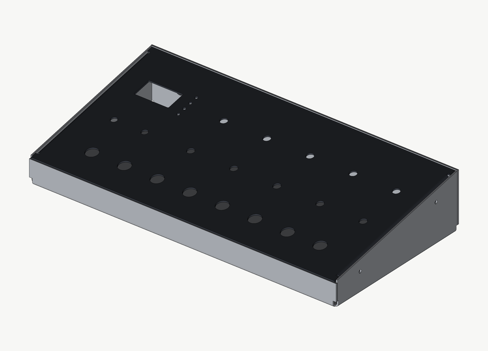

# qfold

Lightweight, agent-friendly sheet metal CAD. You describe a sheet metal body
as a tree of flat faces joined by flanges. qfold turns that into exact solids
and flat patterns, assembles them with STEP parts using `align`, and checks,
renders and draws the result. The geometry kernel is
[OpenCascade](https://github.com/Open-Cascade-SAS/OCCT), the same one under
FreeCAD and build123d, driven by a small C++ tool. Names follow Autodesk
Fusion: Design, Component, Occurrence, Body, Flange, Sheet Metal Rule.

The worked example is a desktop synth case. It has a folded bottom shell (base,
front lip, tall rear wall, wedge cheeks) and a sloped top panel with folded lips
that carry PEM nuts. A control board inserted from a STEP file sits under the
panel, with pots, switches, buttons, LEDs and an OLED through the panel holes.



## What one run produces

`python -m qfold.pipeline out` builds the synth case in about 25 seconds and
writes:

| File | What it is |
| --- | --- |
| `bottom_shell.step`, `top_panel.step` | Each sheet metal part, exact B-rep, mm |
| `assembly.step` | The whole design, with named components and occurrences |
| `*_flat.dxf` | Flat patterns: `CUT` layer, `BEND` centre lines, `NOTES` |
| `synth_case_drawing.pdf` | 5 A3 sheets: assembly and parts list, shell views, shell flat, panel, checks |
| `preview/sheet-*.png` | PNG of each sheet |
| `render_iso.png`, `render_board.png` | Shaded renders of the assembly and the inserted board |
| `report.json` | Every measurement, check result and the parts list |

See [`examples/synth_case`](examples/synth_case) for a committed run.

## Checks

Every run checks its own output. The example passes all 39:

- **Kernel:** each part is one valid solid that doesn't intersect itself. The
  fused solid must hold exactly the volume of its unfused plates and bends,
  folded and flat. Folded minus flat volume must equal what the bend allowance
  predicts (θ·L·T²·(0.5 − K) per bend). Together these show the flat pattern
  and the folded part are the same sheet. They don't prove the bend allowance
  matches your press brake; that's what the fab's K-factor is for.
- **Gaps inside a part:** faces that only meet at a corner, such as a cheek and
  the rear wall, must keep `min_clearance` apart.
- **Assembly:** no interference between any parts. The shell and panel keep
  their clearance, and the board clears the base. Each part is checked on its
  own, so one bad screw fails by name even when the other three are fine.
  Parts held against another must touch it: every screw head on its cheek,
  every foot on the base, and every pot, switch and button on the panel (LEDs
  and the display sit in their holes with clearance). Each screw sits on its
  cheek hole's axis at the right depth and runs on through its lip's PEM hole.
  Each foot sits on its base hole.
- **Board fit:** every part on the inserted board sits on its own panel hole,
  checked across the hole, along its axis and for tilt. Every panel hole has a
  part, and every part has a hole. Only one pot is aligned; the other 24
  parts test whether the board layout matches the panel.
- **DFM:** hole to bend (for each bend's own radius), hole to edge, web between
  holes, holes inside their face, minimum hole size, hardware centre-to-edge
  distance (PEM), bend corner relief, minimum flange length, sheet size.
- **Files:** every STEP is read back and its volume and solid count compared
  with the model. Every DXF is re-opened and checked against the flat pattern:
  extent, each circle's centre and diameter, line and arc counts, total cut
  length, and the bend lines with their DN/UP labels.

`pipeline.check_fit(case, workdir)` runs just the assembly and board fit
checks in about a second, for a quick answer while moving parts around.

These caught two real problems while the example was being built. The first
was a PEM nut too close to the lip bend, fixed by deepening the lip. The second
was the panel's back edge poking 0.01 mm into the rear wall, fixed by allowing
for the edge's tilt. An independent review then found gaps in the checks
themselves: a self-intersecting variant passed, two checks could pass with a
part missing entirely, and bends met at sharp corners without relief. The
self-intersection, contact, screw-axis, corner-relief and DXF census checks
above came out of that review, each with a test that breaks the design on
purpose. A second round found that contact was still checked per group, so one
lifted foot or a screw slid far along its own axis passed while the others
touched. Contact and hole checks now run per part.

## Assemblies

qfold uses Fusion's model, without the timeline or joints:

| Fusion | qfold |
| --- | --- |
| Design, root component | `Design` |
| Component | `Component`: bodies, child occurrences, named refs |
| Occurrence | `Occurrence`: one placed instance of a component |
| Body | `Body`: sheet metal, STEP, or box-and-cylinder stand-in |
| Insert into current design (STEP) | `insert_step`: products become components, instances become occurrences |
| Modify › Align | `align` |
| Parts List | `Design.parts_list()` |
| Sheet Metal Rule, Flange | `SheetMetalRule`, `Flange` |

A ref is a named frame (origin plus axes) on a component. Sheet metal
components get one per tagged hole: `P6` on the outside surface and
`P6.inside` on the inside, both with z out of the outside face. `align` moves
an occurrence so one of its refs lands on another frame:

```python
board = insert_step(design, "control_board.step", kernel.inspect_step(path, work))
align(board, "RV1", onto=panel.ref("P6.inside"))        # pot RV1's origin onto hole P6
align(screw, "origin", onto=shell.ref("S1"))            # under the head, onto the cheek
align(panel, "origin", onto=shell.ref("panel_seat"))    # a ref the shell defines
```

`offset`, `angle` (about the target's z axis) and `flip` adjust the result.
Placement happens once per run, with no solver. The design is rebuilt from code
each time, so an align against "hole P6" follows the hole when it moves.

The stand-in board (`examples/inputs/control_board.step`) is generated by
`design.write_board_step` and written as a named assembly STEP, the way KiCad
exports a board. To use a real board, replace the file and keep the
designators in `design.panel_parts()`.

## How it works

```
design.py    parameters -> sheet metal bodies (faces, flanges, tagged holes)
             -> a Design: components, occurrences, align
fold.py      sheet metal body -> folded plates + bend sectors, and flat pattern
assembly.py  Design, Component, Occurrence, Body, refs, align, insert_step
parts.py     stand-in hardware (pots, switches, screws, feet, PCB)
kernel/      sheetkernel (C++/OCCT): bodies + placed instances in, answers out
dfm.py       manufacturing rules on the layout
shops.py     fab shop bend tables and limits (data in shop_data/*.json)
flat.py      flat pattern in outside-face view, DXF export
render.py    numpy z-buffer renderer (no GPU or display)
drawing.py   SVG sheets: views from hidden-line removal, dims, tables
sheets.py    the synth case's five sheets
pipeline.py  runs it all, writes report.json
```

Python owns the design, the fold math and the assembly tree. The kernel owns
geometry truth and stays stateless: it sees a flat list of body prototypes and
world-placed instances, never the tree. Both states of a sheet metal body come
from the same description, so there is no unfold step that can fail. Overall
dimensions on the drawings are the kernel's measurements of the solids. Hole
tables and feature dimensions come from the model tree. None are typed in.

### Conventions

- Each face has a frame (O, U, V, N). Its 2D (u, v) coordinates lie on the
  *reference surface*, and material spans 0..T along N.
- A flange hangs off a straight parent edge (start p0, direction d, outward o).
  A positive angle folds toward the material side, so the reference surface is
  the outside of the bend and outer dimensions are reference dimensions.
- Bend allowance is θ·(R + K·T), with R the inside radius.
- Flat patterns are shown from the outside face. `DN` means the bend folds away
  from the viewer.

## Placeholders to replace before cutting

These are marked on every drawing:

- Material, inside radius (R1.6) and K-factor (0.42): use your fabricator's
  values (see Shop data below).
- DFM thresholds in `dfm.Rules`, or a shop's from `qfold.shops`.
- Hole sizes for jacks, pots, switches and the PEM centre-to-edge minimum:
  check the part datasheets.
- Stand-in hardware dimensions in `parts.py`: swap in vendor STEP models.

## Shop data

`qfold/shop_data/` holds what each shop publishes about bending and cutting,
copied from its own pages in its own units. The source pages and the date
they were read are in each file. `qfold.shops.spec(shop, material,
thickness_mm)` turns one row into qfold's terms, in mm:

```python
from qfold import shops
s = shops.spec("sendcutsend", "5052 Aluminum", 1.6)
s.rule   # SheetMetalRule: T 1.6002, R 0.889, K 0.455
s.rules  # dfm.Rules: hole to bend 4.72, min flange 5.21, min hole 0.80, sheet 1118 × 762
s.notes  # anything to know, e.g. where K came from
```

| Shop | Bend radius and K | Limits |
| --- | --- | --- |
| SendCutSend | per material and thickness, 10 materials | die-based hole to bend, min flange, min hole, max bent size, max bend length |
| OSH Cut | not public: in their app (app.oshcut.com/catalog) | min hole, web, part size and tolerance per thickness for 5052, A1008, 304, G90 |
| JLCCNC | not public: set by their quote tool | design-guide multiples of T; 0.5–6 mm in 5052, 304, 201, cold-rolled, galvanized |

For OSH Cut and JLCCNC, `rule` stays None until you pass `bend_radius=` and
`k_factor=` read from their app. The limits are there either way. Names are
the shop's own: `shops.materials(shop)` lists them with their stock
thicknesses, and a wrong name or thickness lists the valid ones.

How the published numbers map to qfold's checks:

- SendCutSend's printed K has two decimals. On four rows it disagrees with
  the bend deduction printed beside it, including 0.063 in 5052. qfold uses
  the K that reproduces the bend deduction, since that is what lays out the
  flat pattern. For every row, a test checks that a 90° bend from qfold
  flattens by exactly the shop's bend deduction.
- Formed flange minimums are measured from the outside of the other leg.
  qfold checks the flat wall past the bend, which is R + T shorter. The
  converted value matches SendCutSend's own flat minimum (from the bend
  centre line) to within 0.002 in.
- "Cut features at least half the die width from the bend centre line"
  becomes the hole-to-bend distance from the tangent line: (die − BA)/2.

The synth case passes SendCutSend's limits in 1.6 mm 5052 as designed.

## Setup

On a fresh checkout, one command gets everything and runs the tests. It takes
under 30 seconds and needs only git, so it works in sandboxes without PyPI:

```bash
scripts/bootstrap.sh
python -m qfold.pipeline out
```

The bootstrap script:

- **Checks the platform and tools.** It stops early, with a clear message, if
  the machine isn't Linux x86_64 or is missing git, g++, `rsvg-convert`,
  `qpdf`, `pdftoppm`, numpy, Pillow or pytest.
- **Fetches OpenCascade.** It shallow-clones the `occt-7.9.3-linux-x86_64`
  branch of [qfold-prebuilt](https://github.com/shieldyguy/qfold-prebuilt) into
  `.occt/install`. That repo holds compiled libraries and headers only, for
  Linux x86_64 on Ubuntu 24.04 (glibc 2.38+), so cloning qfold itself stays
  small. The clone must match the commit pinned in the script, and the
  libraries must match `scripts/occt-prebuilt.sha256`. A moved branch or an
  altered library stops the bootstrap instead of being linked silently. An
  interrupted clone is cleared and retried.
- **Gets ezdxf.** If `ezdxf` isn't importable, it sparse-clones the pinned
  release (`src/` only) into `.deps/`. An installed ezdxf takes precedence.
- **Builds sheetkernel and smoke-tests it.** Compiling takes seconds. It then
  checks that every shared library resolves and that a tiny job returns the
  right volume, so glibc or library problems show up here in one line.

On another platform, or to change OpenCascade's build options, build it from
source once and point the kernel at it. This takes about 40 minutes on 2 cores:

```bash
scripts/build_occt.sh .occt
kernel/build.sh                # uses .occt/install by default, or set OCCT_DIR
```

`build_occt.sh` and `bootstrap.sh` share `.occt/install`. Bootstrap refuses to
touch an `.occt/install` that isn't its own prebuilt checkout, so it never
deletes a source build. After a source build, run `kernel/build.sh` and the
tests directly.

To publish a new prebuilt build:

1. In qfold-prebuilt, commit the stripped `lib/` and `include/opencascade/`,
   with the OCCT licence files, on a new orphan branch named for the version
   and platform.
2. Regenerate the manifest: `(cd <install> && sha256sum lib/*.so.*.*.*) >
   scripts/occt-prebuilt.sha256`.
3. Update `occt_branch` and `occt_sha` in `scripts/bootstrap.sh`.

Don't move an existing prebuilt branch; publish a new one. The SHA pin and
the manifest stop a moved branch from being used anyway.

## Next

- Shop and material as design parameters, with R, K and the DFM limits looked up
- Hems, jogs and non-90° bends in the example
- A real KiCad board STEP in place of the stand-in, and vendor part models
- A rear-wall board for the jacks, aligned the same way as the panel board
- An MCP server so an agent can call build, measure, render and check as tools
